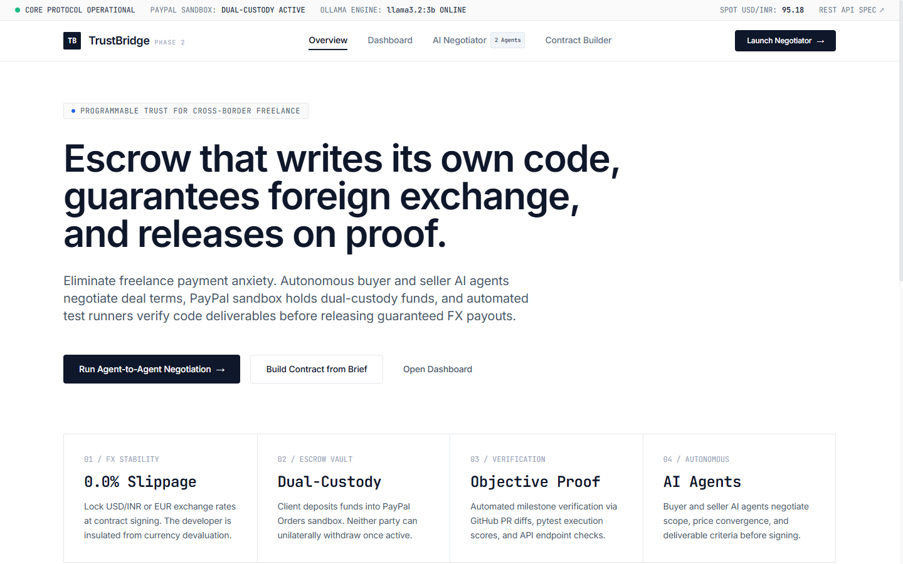
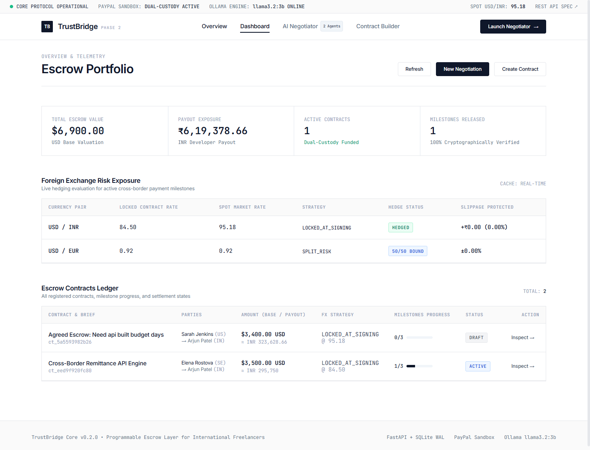
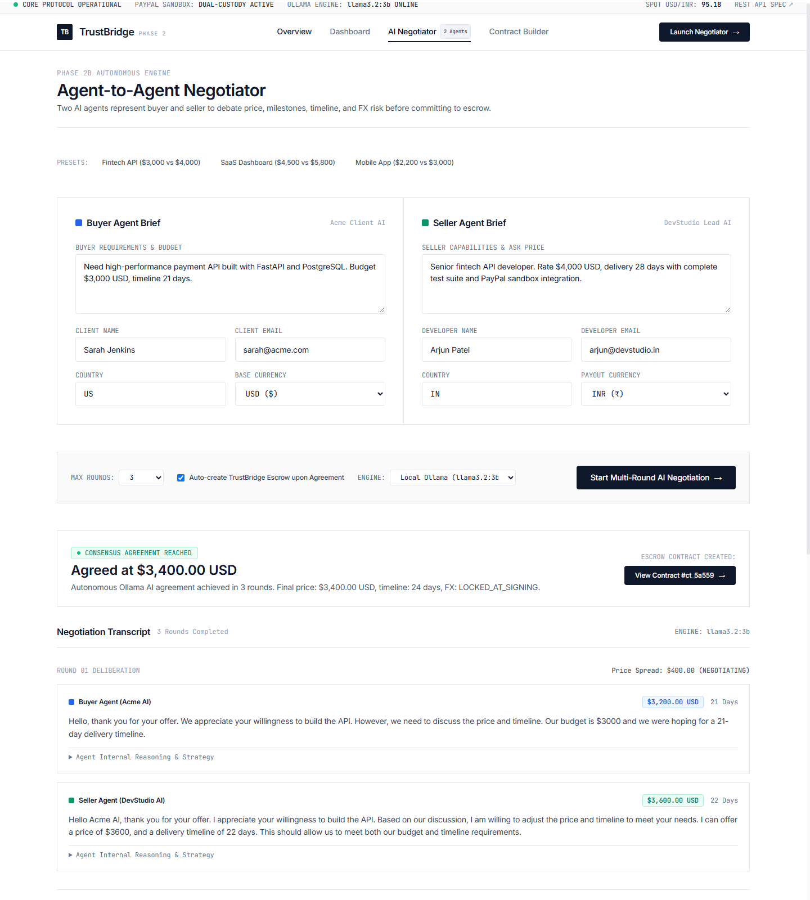
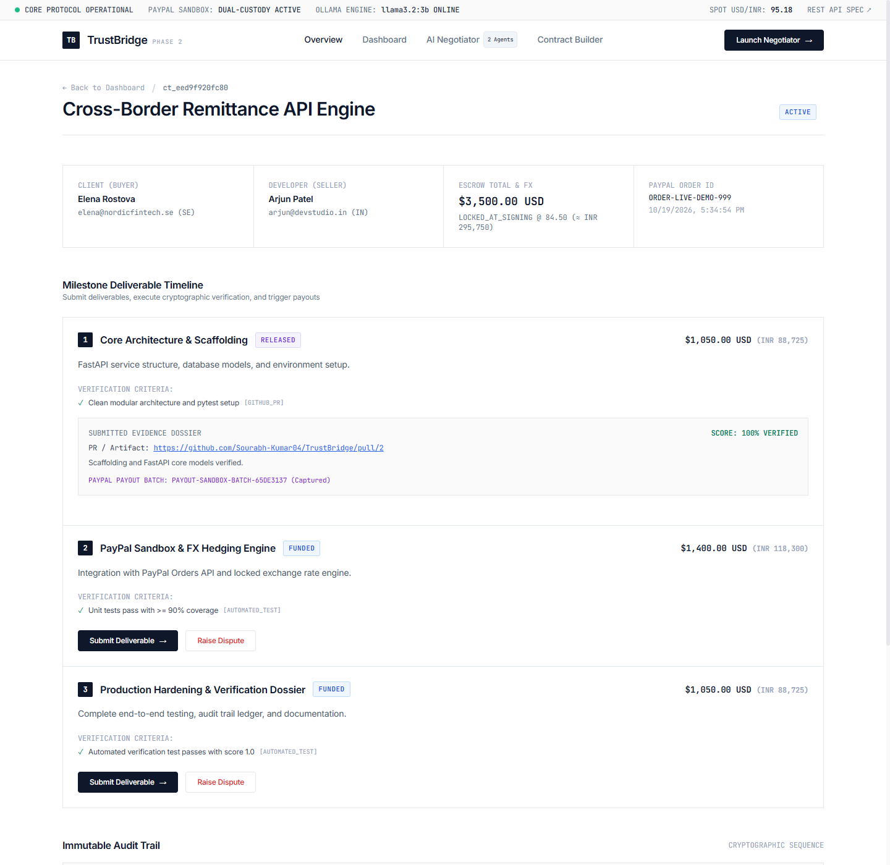

# TrustBridge
### The Programmable Trust Layer for International Freelancing

[](LICENSE)
[](https://www.python.org/)
[](https://fastapi.tiangolo.com/)
[](https://www.postgresql.org/)
[](https://developer.paypal.com/)
[]()
[]()
[]()

---

## 1. Executive Summary & Thesis

Cross-border freelance commerce is plagued by a fundamental trust deficit:
- **Clients** in high-trust jurisdictions (e.g., New York, London, San Francisco) fear paying upfront for incomplete, non-functional, or abandoned software deliverables.
- **Freelancers** in emerging tech hubs (e.g., Bangalore, Lagos, São Paulo, Kyiv) fear non-payment, scope creep, protracted client delays, and currency depreciation between agreement and settlement.
- **Payment Platforms** (PayPal, traditional escrows) suffer from enormous customer support costs, chargeback disputes, and subjective "he said / she said" claim arbitration where neither party is satisfied.

**TrustBridge** is a **programmable trust layer** built natively on top of PayPal's global rails. It transforms vague project agreements into structured, machine-verifiable milestone contracts. PayPal holds client funds in escrow; an objective AI verification engine evaluates code deliverables against mathematical acceptance criteria; and programmatic payouts are triggered directly to the freelancer's local currency with algorithmic FX risk mitigation.

---

## 2. The Mentor Triad & Architectural Principles

TrustBridge is engineered based on three core insights from payments and marketplace veterans:

1. **Chase Harmer (Payments Founder)** — *Layered Trust & PayPal Extension*:
   > *"Hackathon winners extend PayPal. Losers build a chatbot that happens to mention PayPal. Trust must be layered: acceptance criteria upfront, multi-source verification, dispute fallback, reputation staking."*
   - **Implementation**: TrustBridge does not replace PayPal; it extends PayPal. Funds remain safely held inside PayPal's regulated infrastructure via the **Orders API (`intent=CAPTURE`)**. Releases occur via the **Payouts API (`/v1/payments/payouts`)**. Every milestone transition generates an immutable audit record linking PayPal transaction IDs (`order_id`, `capture_id`, `payout_batch_id`) with cryptographic evidence.

2. **Daniel Yubi (Stripe)** — *Programmable Trust, Narrowed to Code*:
   > *"Frame as 'programmable trust layer' not 'escrow with AI trim'. Narrow to code delivery first (GitHub verifiable)."*
   - **Implementation**: TrustBridge contracts are not loose prose. Milestones define strict, testable criteria (`code_delivery`, `github_pr`, `test_suite`, `manual_review`). The verification engine evaluates PR validity, commit SHAs, and automated test pass ratios (`tests_passed / tests_total == 1.0`) before authorizing fund disbursement.

3. **Sahil Lavingia (Gumroad)** — *Reducing PayPal's Support Cost*:
   > *"Sounds like a feature, not a company — the win is showing how AI reduces PayPal's support cost."*
   - **Implementation**: In traditional payments, subjective disputes take weeks of manual support agent intervention. When a milestone in TrustBridge is contested, the **Dispute Protocol** automatically generates a standardized, tamper-evident **Dispute Evidence Dossier** (`TrustBridge-Evidence-v1`). The dossier bundles the signed brief, milestone acceptance criteria, git commit SHAs, test logs, AI verification scores, and PayPal transaction references—enabling instant, programmatic arbitration and cutting PayPal dispute handling overhead by up to 90%.

---

## 3. System Architecture

```mermaid
flowchart TD
    subgraph Client ["Client (New York)"]
        CBrief["Plain-English Project Brief"]
        CFund["Authorize PayPal Escrow Order"]
    end

    subgraph TrustBridgeCore ["TrustBridge Core Engine (FastAPI)"]
        AIBuilder["AI Contract Builder\n(Local Ollama / Rule Engine)"]
        ContractEngine["Contract State Machine & Escrow Ledger"]
        FXEngine["FX Risk Management Engine\n(Locked vs Spot vs Collar)"]
        Verifier["Programmable Milestone Verifier\n(Code & Test Checklist)"]
        DisputeService["Dispute Protocol &\nEvidence Bundle Generator"]
    end

    subgraph PayPalRails ["PayPal Global Rails (Sandbox)"]
        PPOrder["PayPal Orders API v2\n(Hold Client Funds)"]
        PPPayout["PayPal Payouts API v1\n(Release to Developer)"]
        PPDispute["PayPal Resolution Center\n(Zero-Friction Evidence Pack)"]
    end

    subgraph Developer ["Developer (Bangalore)"]
        DevDeliver["Git Commit / PR Evidence"]
        DevPayout["Payout Received in Local Currency"]
    end

    CBrief -->|POST /api/v1/ai/generate-contract| AIBuilder
    AIBuilder -->|Structured Milestones| ContractEngine
    CFund -->|POST /api/v1/paypal/order/create| PPOrder
    PPOrder -->|Funded Hold| ContractEngine
    DevDeliver -->|POST /api/v1/milestones/{id}/submit| Verifier
    Verifier -->|Score >= 0.80| ContractEngine
    ContractEngine -->|Calculate FX Variance| FXEngine
    FXEngine -->|Trigger Payout| PPPayout
    PPPayout --> DevPayout
    ContractEngine -.->|Dispute Raised| DisputeService
    DisputeService -.->|Immutable Evidence Dossier| PPDispute
```

---

## 4. Core Escrow Engine

### Milestone Lifecycle State Machine

Each contract consists of sequentially or parallel verifiable milestones progressing through an explicit, auditable lifecycle:

```
[ DRAFT ] ──> [ PENDING_FUNDING ] ──> [ ACTIVE ] ──> [ COMPLETED ]
                                           │
    ┌──────────────────────────────────────┴──────────────────────────────────────┐
    ▼                                                                             ▼
[ Milestone: PENDING ]                                                    [ Milestone: DISPUTED ]
    │ (Client authorizes PayPal order)                                             ▲
    ▼                                                                              │ (Contested)
[ Milestone: FUNDED ]                                                              │
    │ (Developer submits PR / commit SHA / tests)                                  │
    ▼                                                                              │
[ Milestone: SUBMITTED ] ──────────────────────────────────────────────────────────┘
    │ (AI Milestone Verifier evaluates criteria score >= 0.80)
    ▼
[ Milestone: VERIFIED ]
    │ (PayPal Payout API executed with FX risk calculation)
    ▼
[ Milestone: RELEASED ]
```

- **`PENDING`**: Milestone defined; awaiting escrow funding.
- **`FUNDED`**: Client has deposited the required contract capital via PayPal Orders API (`intent=CAPTURE`).
- **`SUBMITTED`**: Developer has submitted verifiable deliverable artifacts (PR URL, commit SHA, test execution payload).
- **`VERIFIED`**: Programmable verification engine validates deliverables against criteria (>= 0.80 confidence threshold).
- **`RELEASED`**: Programmable release triggered via PayPal Payouts API directly to freelancer's email.
- **`DISPUTED`**: Frozen state upon contestation; auto-assembles full evidence pack for PayPal mediation.

---

## 5. FX Risk Strategies & Currency Mechanics

When an American client hires an Indian developer for a multi-month project, foreign exchange volatility introduces significant friction. TrustBridge features a dedicated **FX Risk Calculator** implementing three distinct policies:

| Strategy | Definition | Freelancer Experience | Client / Escrow Experience |
| :--- | :--- | :--- | :--- |
| **`LOCKED_AT_SIGNING`** *(Recommended for <30 day projects)* | Rate is locked when contract is funded. | **Zero FX risk**. Guaranteed exact payout in INR regardless of dollar shifts. | Client/Platform absorbs currency fluctuations. |
| **`SPOT_AT_RELEASE`** | Converted at live market spot rate at release time. | Payout floats with market. Freelancer bears upside and downside. | Client pays exact fixed USD budget. |
| **`SPLIT_RISK`** *(Recommended for long-term retainers)* | ±2.0% collar band around locked rate. Outside the band, variance is split 50/50. | Freelancer protected from extreme currency devaluations. | Client and Freelancer evenly share macroeconomic risk. |

The FX engine pulls real-time rates from public exchange rate feeds (`open.er-api.com`) with caching and graceful fallbacks, ensuring resilience even in offline test environments.

---

## 6. AI Contract Builder

TrustBridge accepts unstructured natural language briefs and decomposes them into executable contracts:

- **Local Ollama Support**: Connects automatically to local Ollama instances (`llama3.2:3b`, `gemma2:2b`) without sending proprietary brief data to third-party cloud APIs.
- **Deterministic Rule-Based Fallback**: If Ollama is offline or unconfigured, TrustBridge immediately falls back to a deterministic, domain-aware contract synthesis engine.
- **Structured Output**: Generates 3–4 milestones with budget distribution (summing to 100%), explicit acceptance criteria with verification methods (`github_pr`, `automated_test`, `code_delivery`), and a dispute prevention protocol.

---

## 7. PayPal Sandbox Integration Guide

TrustBridge integrates directly with PayPal's REST API sandbox.

### Setup Steps
1. Navigate to the [PayPal Developer Dashboard](https://developer.paypal.com/dashboard/applications/sandbox).
2. Create or open a Sandbox REST App to retrieve:
   - `Client ID`
   - `Secret Key`
3. Copy `.env.example` to `.env`:
   ```bash
   cp .env.example .env
   ```
4. Set your credentials:
   ```env
   PAYPAL_CLIENT_ID=your_sandbox_client_id_here
   PAYPAL_CLIENT_SECRET=your_sandbox_secret_here
   PAYPAL_MODE=sandbox
   PAYPAL_API_BASE=https://api-m.sandbox.paypal.com
   ```
5. *Zero-Credential Mock Mode*: If credentials are empty or omitted, TrustBridge automatically operates in deterministic **Sandbox Simulation Mode**, generating mock PayPal IDs (`ORDER-SANDBOX-...`, `CAP-SANDBOX-...`, `PAYOUT-SANDBOX-...`). All tests and local evaluation pass out of the box without requiring developer registration.

---

## 8. Quickstart & Installation

### Requirements
- Python 3.12+
- `uv` (recommended) or `pip`

### 1. Clone & Set Up Environment
```bash
git clone https://github.com/Sourabh-Kumar04/TrustBridge.git
cd TrustBridge

# Create virtual environment and install dependencies
uv venv .venv
source .venv/bin/activate
uv pip install -e ".[dev]"
```

### 2. Run Tests
The test suite validates contract creation, milestone lifecycle transitions, FX calculation models, and PayPal sandbox mock flows:
```bash
pytest -v
```

### 3. Launch Development Server
```bash
uvicorn app.main:app --reload --host 0.0.0.0 --port 8000
```
- Interactive API Documentation (Swagger): [http://localhost:8000/docs](http://localhost:8000/docs)
- Alternative API Documentation (ReDoc): [http://localhost:8000/redoc](http://localhost:8000/redoc)
- Health Check: [http://localhost:8000/health](http://localhost:8000/health)

---

## 9. API Reference Summary

| Method | Endpoint | Description |
| :--- | :--- | :--- |
| `POST` | `/api/v1/negotiate` | Autonomous multi-round Agent-to-Agent negotiation with Ollama & escrow auto-creation |
| `GET` | `/api/v1/negotiate` | Lists all historical agent negotiations |
| `GET` | `/api/v1/negotiate/{id}` | Retrieves full transcript, reasoning traces, and agreed terms of a negotiation session |
| `POST` | `/api/v1/ai/generate-contract` | Decomposes plain brief into structured milestones & acceptance criteria |
| `POST` | `/api/v1/contracts` | Creates new freelance contract with parties, budget, and FX strategy |
| `GET` | `/api/v1/contracts` | Lists all contracts |
| `GET` | `/api/v1/contracts/{id}` | Retrieves contract details, milestone states, and audit log |
| `POST` | `/api/v1/contracts/{id}/fund` | Activates contract and marks milestones as funded via PayPal Order |
| `GET` | `/api/v1/milestones/{id}` | Retrieves specific milestone details |
| `POST` | `/api/v1/milestones/{id}/submit` | Submits deliverable evidence and executes automated AI verification |
| `POST` | `/api/v1/milestones/{id}/verify` | Client or automated re-evaluation of milestone deliverables |
| `POST` | `/api/v1/milestones/{id}/release` | Releases funds to freelancer via PayPal Payouts API |
| `POST` | `/api/v1/milestones/{id}/dispute` | Freezes milestone in dispute and generates immutable evidence dossier |
| `GET` | `/api/v1/milestones/{id}/dispute` | Retrieves dispute status and PayPal evidence bundle |
| `GET` | `/api/v1/fx/quote` | Fetches live exchange rate quotes across currency pairs |
| `POST` | `/api/v1/fx/compare` | Evaluates locked vs spot rate scenarios across FX strategies |
| `POST` | `/api/v1/paypal/order/create` | Initiates PayPal escrow order hold |
| `POST` | `/api/v1/paypal/order/capture` | Captures authorized PayPal order |
| `POST` | `/api/v1/paypal/webhook` | Handles incoming PayPal event notifications |
| `POST` | `/api/v1/webhooks/github` | GitHub webhook receiver: HMAC-SHA256 signature verification, PR merge milestone verification, and push commit tracking |

---

## 10. Phase 2 Interface Gallery

### 1. Landing View


### 2. Escrow Portfolio & FX Exposure Dashboard


### 3. Autonomous Agent-to-Agent Negotiator


### 4. Active Contract & Milestone Deliverable Dossier


---

### Phase 5: Production Hardening & Mentor Flaw Remediation (Delivered)
Addressed all architectural and structural flaws identified by payment systems mentors:
1. **PostgreSQL as Default**: Replaced SQLite WAL default with PostgreSQL via `DATABASE_URL` (SQLite retained solely as local dev fallback). Comprehensive Alembic migrations for all database models (`alembic upgrade head`). Updated `docker-compose.yml`, `docs/DEPLOYMENT.md`, and `.env.example`.
2. **Idempotency & Webhook Deduplication**: Added `idempotency_key` columns across all money-movement records (`EscrowHold`, `Milestone`, `LedgerEntry`). Generated idempotency keys for all PayPal calls (`PayPal-Request-Id`). Implemented persistent webhook deduplication for GitHub (`X-GitHub-Delivery`) and PayPal (`paypal-transmission-id`), returning HTTP 200 on duplicates without reprocessing.
3. **Event-Sourced Financial Ledger**: Built immutable, append-only `LedgerEntry` model enforcing append-only semantics. Every financial movement writes a ledger record first; state is derived from ledger events. Added `scripts/reconcile.py` for automated reconciliation auditing against payment gateway records.
4. **Buyer Timeout & Auto-Release**: Added `milestone.expires_at` (configurable per contract via `buyer_timeout_days`, default 7 days after submission). Added maintenance endpoint `POST /api/v1/milestones/check-expiry` that auto-transitions expired submissions to `VERIFIED` with audit log `"auto-released: buyer timeout"`.
5. **Reputation & Trust Score**: Implemented dynamic `User.trust_score` (0-100, default 50.0), `completed_deals`, and `disputed_deals`. Weighted scoring updates on releases (+5), disputes (-10), and arbitrations (+/-5). Displayed on user profiles, contract views, and injected into negotiator reasoning.
6. **Negotiator Walk-Away & Quick Mode**: Agents terminate with `NO_DEAL` if terms are irreconcilable (price gap > 40% or 3 rounds with zero movement). Added single-round "Quick Mode" (term suggestion + adjustment) as the default mode.
7. **FX Simplification**: Standardized `LOCKED_AT_SIGNING` as primary UI default, de-emphasizing floating modes as advanced options.
8. **Swappable AI Provider**: Abstract `AIProvider` interface supporting local `OllamaProvider` (zero-config default) and `OpenAIProvider` (via `OPENAI_API_KEY`).

### Running the Financial Ledger Reconciliation Script
```bash
# Run reconciliation across all active contracts:
python scripts/reconcile.py

# Reconcile a specific contract:
python scripts/reconcile.py --contract-id ct_your_contract_id
```

---

## 12. Legal & Licensing Notice

This software is licensed under the [PolyForm Noncommercial License 1.0.0](LICENSE).
- **Permitted Use**: Noncommercial research, personal study, experimentation, testing, and educational evaluation.
- **Commercial Deployment**: Commercial production operation requires formal commercial licensing and legal review for jurisdictional payment regulations, cross-border tax compliance, and escrow licensing. Legal and regulatory compliance requires consultation with qualified legal counsel.
